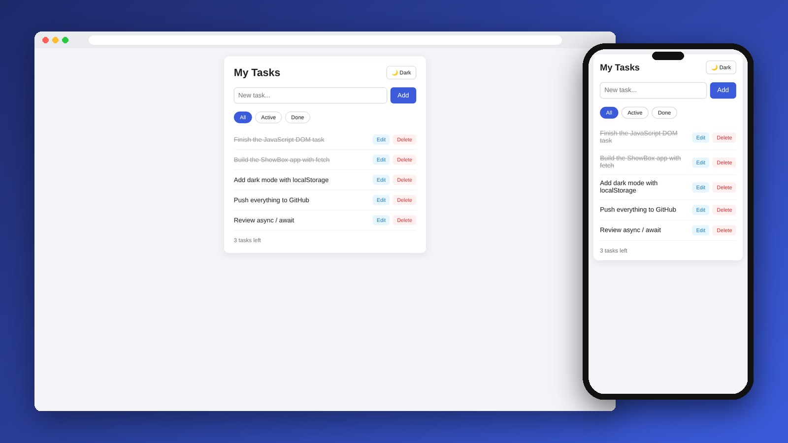
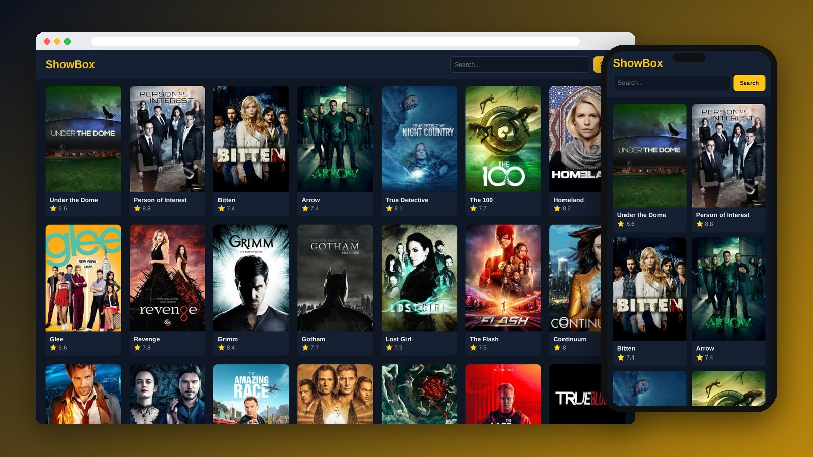

<div align="center">

# Todo App & ShowBox

Two vanilla JavaScript apps practicing the DOM, events, async / await, Fetch API and browser storage.

[](https://mo7-adad.github.io/task-27-10/todo/)
[](https://mo7-adad.github.io/task-27-10/showbox/)

    

</div>

---

### Todo App



### ShowBox



## Todo App

- Add, edit, delete and complete tasks (CRUD on an array)
- Event delegation with one listener on the list
- Tasks saved in **localStorage**
- Filter: All / Active / Done
- "X tasks left" counter
- Dark mode saved in **localStorage**
- Welcome banner shown once per tab with **sessionStorage**

## ShowBox

- Loads TV shows from the [TVMaze API](https://www.tvmaze.com/api) when the page opens
- Search shows by name
- `fetch` + `async / await` + `try / catch`
- Loading, empty and error states

## Project Structure

```
task-27-10/
├── index.html
├── todo/ (index.html, style.css, app.js)
└── showbox/ (index.html, style.css, app.js)
```

## Run Locally

```bash
git clone https://github.com/mo7-adad/task-27-10.git
cd task-27-10
```

Then open `index.html` in your browser, or right-click it in VS Code and choose **Open with Live Server**.

## Author

**Mohamed Al-hadad** — Front-End Developer

[](https://github.com/mo7-adad)
